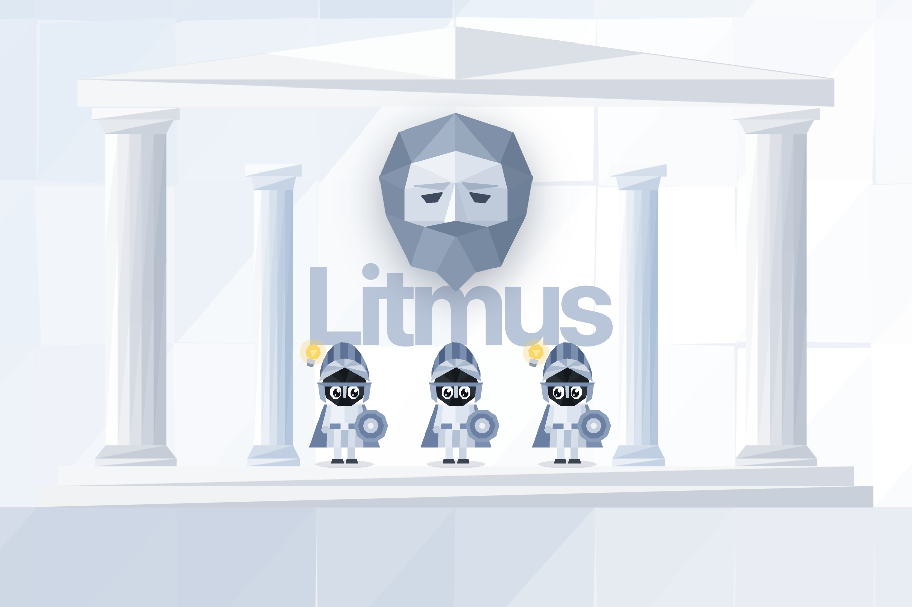

<p align="center"></p>

# Litmus

Turn the claims you highlighted in research papers into real experiments, run them with parallel AI agents, and steer
the research at every step.

Built for the Papiers Human-Centred Autoresearch Challenge at Hack the Valley 11.

## What it does

Papers are full of claims, and checking whether one holds in your own setup means training, rerunning on more seeds and
comparing numbers by hand. Litmus does that loop for the claims you already marked.

1. **Connect your library.** Litmus reads your highlights and notes from Papiers and keeps the
   ones about what you are researching. Your notes count most: they are your doubts.
2. **Pick a claim.** Litmus, the lead researcher, drafts the first experiment and dispatches an agent.
3. **Agents run real experiments.** Each one trains on CIFAR-10 on an NVIDIA A100, five paired seeds, against its parent
   re-run at the same settings. A locked statistics module grades it: confirmed, refuted or inconclusive, with a
   confidence interval.
4. **You steer.** When a result comes back refuted, the agent searches your library for why and asks you what to do.
   Each agent suggests its own next experiments; you choose which run, up to four in parallel.
5. **Ask Litmus.** Chat about one agent or the whole research. **Explore this topic further** searches arXiv for related
   papers you have not read yet, so the next step can start with reading.
6. **Write it up.** Litmus writes an abstract in which every sentence cites the experiment and the highlight behind it.
7. **Back to Papiers.** Once you approve, each claim an agent tested gets a highlight in Papiers tinted by its verdict,
   with the results in its note, and any paper autoresearch found can be added to your library in one click.

The research grows as a map around Litmus: each node is a training run that actually happened, each line one change,
traced to the highlight, note or decision it came from.

## How it works

```
Papiers CLI ──▶ library (highlights, notes)          Modal (A100): airbench94, 5 seeds, epochs streamed live
                    │                                        ▲
                    ▼                                        │
React + three.js ◀──WebSocket── FastAPI ◀── LangGraph engine ┴──▶ grader (paired t-intervals, locked)
   (you steer)  ──REST────────▶          (one branch per agent:  run → grade → reflect → suggest)
```

- **Engine.** A LangGraph graph with one parallel branch per agent. A question pauses only its own branch, and SQLite
  checkpoints let a restarted server resume every session exactly where it was.
- **Fair comparisons.** Every child is graded against its parent re-run on the same seeds, and training length is fixed
  for every experiment, so results compare directly. Borderline results get five more seeds automatically.
- **Grounded reasoning.** OpenAI structured outputs power Litmus's chat, each agent's next steps, the suggested
  questions and the abstract. Citations to anything the model was not given are stripped.
- **Cheap reruns.** Results are cached by configuration and seed, so a repeated run costs nothing.
- **Demo mode.** A switch on the home page runs the experiments in the browser, simulated and calibrated from a recorded
  real session, while Litmus still answers with the real model. No GPU time needed.

The REST API and event stream are specified in [`shared/contract.md`](shared/contract.md).

## Tech stack

| Area | Technologies |
|---|---|
| Frontend | React 19, TypeScript, Vite, Tailwind CSS v4, three.js (react-three-fiber, drei), Motion, zustand, d3 |
| Backend | Python 3.11, FastAPI, Uvicorn, Pydantic, LangGraph with SQLite checkpoints, SQLite |
| AI | OpenAI Responses API (structured outputs) |
| Compute | Modal (A100), PyTorch, [airbench94](https://github.com/KellerJordan/cifar10-airbench) on CIFAR-10 |
| Research data | Papiers CLI, arXiv API |
| Statistics | SciPy |

## Getting started

### Prerequisites

- Node.js 22+ and npm
- Python 3.11 with [uv](https://docs.astral.sh/uv/)
- For live runs: an OpenAI API key, a [Modal](https://modal.com) account (`uv run modal setup`), and the Papiers CLI
  (`npm install -g papiers`, then `papiers auth login`)

### Run

```bash
cp .env.example backend/.env   # add OPENAI_API_KEY (and PAPIERS_TOKEN if you have not logged in)
./dev.sh                       # backend on :8000, frontend on http://localhost:5173
```

The first live run needs the trainer deployed once: `cd backend && uv run modal deploy litmus/modal_app.py`.

To try it without keys or a GPU, run only the frontend and turn on **Demo mode** at the top right of the home page:

```bash
cd frontend && npm install && npm run dev
```

### Tests

```bash
cd backend && uv run pytest     # engine, API contract, grader (CPU only)
cd frontend && npm test         # reducer, layout, simulator, grader port
```

## Project structure

```
backend/    FastAPI app, LangGraph engine, grader, Papiers and arXiv clients, Modal trainer
frontend/   React app: workspace, 3D scene, in-browser demo backend
shared/     API and event contract, recorded demo session
video/      Remotion overlays and captions for the demo video
```

Contributor notes, design decisions and the verification log are in [`AGENTS.md`](AGENTS.md).

## Acknowledgements

- [airbench](https://github.com/KellerJordan/cifar10-airbench) by Keller Jordan (MIT; vendored with its license in
  `backend/litmus/experiments/LICENSE-airbench`)
- Papiers, whose library and CLI Litmus is built on
- The papers in the demo library: Jordan, *94% on CIFAR-10 in 3.29 Seconds on a Single GPU*; Szegedy et al.,
  *Rethinking the Inception Architecture*; Müller, Kornblith and Hinton, *When Does Label Smoothing Help?*; Zhang et al.,
  *mixup: Beyond Empirical Risk Minimization*; He et al., *Bag of Tricks for Image Classification*
- The statue is the Artemision Bronze, from the public-domain 3D scan by SMK, the National Gallery of Denmark
